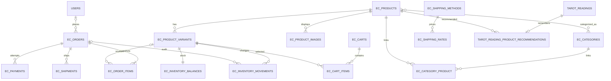

# DB設計案

## 注意事項

本設計はmigration定義から確認できた既存スキーマを前提にした提案であり、DBには接続していない。稼働DBとの差分、MySQLのバージョン/設定、過去のデータ量を実装前に確認する。テーブル名・列・型・状態値はレビュー前の案である。

金額は浮動小数点でなく通貨最小単位の整数（例：JPYの円）で保持し、すべての金額に通貨コードを持たせる。価格・税・送料は注文確定時に再計算し、注文にスナップショットする。

## 既存スキーマ確認

既存migrationが定義する主要テーブルと関係：

- `users`: 基本認証項目にrole/is_active、Google ID、プラン/占いクレジット、Stripe顧客・サブスクリプション情報が追加されている。
- `tarot_readings`: `user_id` FK、質問/カード/解釈、nullableカテゴリ/要約/日次日付、作成日時index、`user_id + daily_reading_date` unique。
- `guest_trial_credits`: `device_hash` PK、使用クレジットとtimestamps。旧`guest_trial_credits`は`legacy_guest_trial_ip_credits`へrenameされた履歴がある。
- Stripe: `stripe_credit_purchases`、`stripe_webhook_events`。ほかLaravel標準のusers/session/cache/queue関連テーブルがある。

正確な既存列は[調査結果](./01-existing-system-analysis.md)を参照。既存テーブルの実データやmigration適用状況は未確認。

## ER図（提案）

## 新規テーブル候補と定義

### カタログ・在庫

| テーブル | 主な列・制約案 | 用途/注意 |
|---|---|---|
| `ec_products` | id, slug unique, name, description nullable, status, `reading_recommendable`, timestamps, deleted_at | 商品基本情報。`reading_recommendable`は管理設定。参照中商品はsoft delete/アーカイブ |
| `ec_product_variants` | id, product_id FK, sku unique, label, options JSON nullable, price_minor, currency, is_active, timestamps | SKU/価格をvariant単位にする。単一商品は標準variantを1件用意 |
| `ec_categories` | id, name, slug unique, status, sort_order, timestamps | カテゴリ。論理削除/アーカイブを検討 |
| `ec_category_product` | category_id FK, product_id FK, composite unique | 商品と複数カテゴリのpivot |
| `ec_product_images` | id, product_id FK, storage_disk, path, alt_text, sort_order, timestamps | ファイル本体はStorageに置き、DBはdisk/pathを保持。公開URLの直書きは避ける |
| `ec_inventory_balances` | variant_id PK/FK, on_hand, reserved, updated_at | 現在庫と予約数。CHECKで非負を要求可能か対象MySQLで確認。販売可能数は差分 |
| `ec_inventory_movements` | id, variant_id FK, order_id nullable FK, movement_type, quantity, idempotency_key unique, actor_user_id nullable, note nullable, created_at | 入庫、予約、予約解放、販売確定、調整の監査台帳。quantityの符号規約を実装前に固定 |

商品販売可能条件は、`status=published`、商品/variant有効、購入可能数が1以上とする案。variantごとの在庫表が1:1であることを登録時に保証する。

### カート・注文・決済

| テーブル | 主な列・制約案 | 用途/注意 |
|---|---|---|
| `ec_carts` | id, user_id nullable FK, guest_token_hash nullable unique, expires_at, timestamps | ログイン/ゲスト共通のカート。生の推測困難tokenは署名/ハッシュ管理。本人確認と統合規則が要る |
| `ec_cart_items` | id, cart_id FK, variant_id FK, quantity, timestamps, unique(cart_id, variant_id) | 商品選択。カート価格を確定情報として信用しない |
| `ec_orders` | id, order_number unique, idempotency_key unique, nullable user_id, 状態/決済状態, 暗号化連絡先・配送先, 金額/税率スナップショット, reservation_expires_at, guest_access_token_hash/guest_access_expires_at | 注文時点の事実を保持。ゲスト署名URLの署名hashを保存し、期限切れ・管理操作で失効可能 |
| `ec_order_items` | id, order_id FK, variant_id nullable FK `nullOnDelete`, product_name_snapshot, variant_name_snapshot, sku_snapshot, unit_price_minor, quantity, tax_minor, line_total_minor, currency | 商品削除/価格変更に影響されない注文明細 |
| `ec_payments` | id, order_id FK, provider, provider_checkout_id nullable unique, provider_payment_id nullable unique, status, amount_minor, currency, idempotency_key unique, paid_at nullable, timestamps | 決済試行の状態・外部参照のみ。PAN/CVC/磁気情報、秘密鍵を保存しない |
| `stripe_webhook_events`（既存） | Stripe event ID unique, type, processed_at | 既存Stripeクレジット処理専用。ECでは共用しない |

住所列案：recipient_name、postal_code、prefecture/region、city、address_line1/2、phone。必要最小限の列とし、発送後の保持期間を定義する。注文確認に必要なメールアドレスは注文のスナップショットとして記録する。

### 配送・送料

| テーブル | 主な列・制約案 | 用途/注意 |
|---|---|---|
| `ec_shipping_methods` | id, code unique, name, is_active, timestamps | 配送方法/配送会社設定。配送会社契約・API連携とは分離 |
| `ec_shipping_rates` | id, shipping_method_id FK, country_code, fee_minor, currency, is_active, timestamps | 国別固定送料。配送可能国と料金は運用設定し、設定のない国は注文不可 |
| `ec_shipments` | id, order_id FK, shipping_method_id nullable FK, carrier_name nullable snapshot, tracking_number nullable, status, shipped_at nullable, delivered_at nullable, timestamps | 注文と配送を分離し、分割発送を許容。追跡番号の閲覧権限を制御 |
| `ec_tax_rates` | id, country_code, tax_basis_points, active_from, active_until nullable, is_active, timestamps | 税込価格から税額を求める国別ルール案。専門家確認後に設定し、未設定国はチェックアウト不可 |
| `ec_payment_webhook_events` | id, provider, event_id, event_type, status, failure_reason, processed_at, timestamps, unique(provider, event_id) | EC決済の再送を冪等化し、既存Stripeクレジット用台帳から責務を分離 |
| `ec_order_emails` | id, order_id FK, email_type, status, sent_at nullable, unique(order_id, email_type) | 注文メールの再試行と重複送信抑止 |

### タロット推薦

| テーブル | 主な列・制約案 | 用途/注意 |
|---|---|---|
| `tarot_reading_product_recommendations` | id, tarot_reading_id unique FK, product_id FK, selected_at, timestamps | ログインユーザーの1結果に対する推薦を固定。タロット本体にEC列を追加しない。参照中商品は物理削除しない |

ゲスト結果は現状DBに保存せず、sessionに保存している。ゲスト推薦も同じ商品を示すには、選択IDをセッション結果に含め、共有URL用Cacheにも最小限の推薦IDを同時に保持する。共有Cacheは既存の30日期限に従い、推薦情報欠落/無効でも占いを表示する。

ゲスト注文の照会tokenは`ec_orders`に生値を置かず、照合用hashと有効期限を保持する案。ログイン注文はuser_idで所有者を照合する。

## 主要制約・index

- SKU unique、slug unique、カテゴリslug unique、注文番号 unique、決済外部ID unique、イベントID unique、在庫台帳のidempotency key unique。
- 注文明細は商品名・価格・数量のスナップショットを必須にする。
- `ec_inventory_balances`はvariant_id単位に一行とし、ロック下でon_hand/reservedを更新。利用可能数を負にしない。
- 一注文に重複商品variantが生じないようcart item uniqueと注文作成側の集約を行う。
- 商品一覧は公開状態・カテゴリ・名称検索に対応するindexを、注文一覧はcreated_at/status/order_numberに、履歴は外部参照IDに適切に張る。実データ件数に基づき調整。
- 参照履歴のある注文/明細/在庫移動/Webhook記録は通常のカスケード削除対象にしない。

## アカウント削除・保持

現在はユーザー削除が`tarot_readings`をcascade削除する。ECの注文は`user_id nullOnDelete`とし、購入履歴の保持が必要な場合もユーザー識別子・連絡先を残し続けてよいとは限らない。法令・会計・問い合わせ対応の必要期間、匿名化方法、本人からの削除請求時の扱いを決定してからFKと削除処理を実装する。

## 要決定

1. MySQLのバージョンとCHECK/JSON/lockingの実装可否。
2. 指定する海外配送先、各地域の送料、専門家確認済みの税率/税の徴収義務。税込商品明細ごとの端数処理は四捨五入で決定済み。
3. Stripe Checkout期限との安全余裕として予約は30分30秒。30分を厳密な期限とするか、決済成功と期限切れ競合をどう運用するかを公開前に確認する。
4. カート保持期間、ゲストtokenの有効期間/失効方法、認証後のカート統合動作。
5. 住所の暗号化、アクセス履歴、注文/決済/個人情報の保管・匿名化期間。
