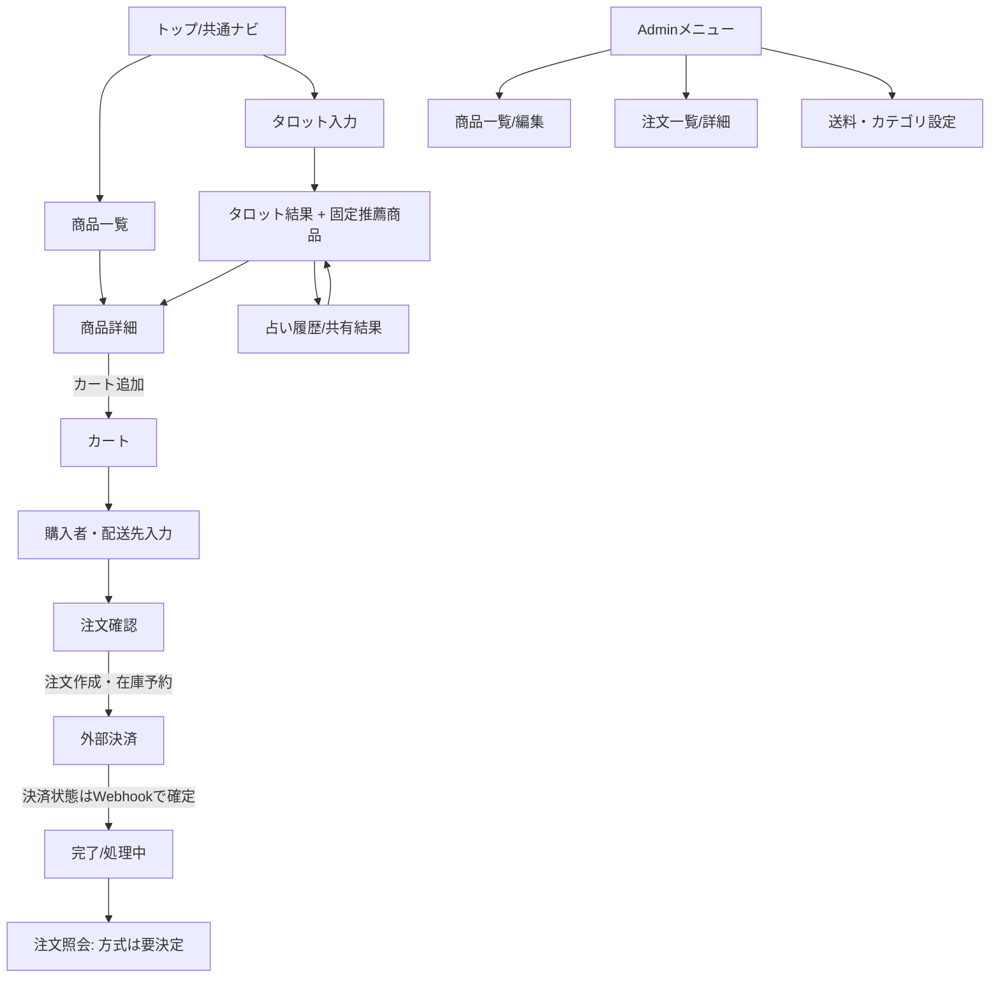

# 画面一覧・画面遷移

## 画面一覧（案）

| ID | 画面 | 利用者 | 主な内容・操作 | 主な認可 |
|---|---|---|---|---|
| S-01 | 商品一覧 | 全員 | 商品カード、検索、カテゴリ、並び替え、ページ切替 | 公開商品だけ |
| S-02 | 商品詳細 | 全員 | 商品説明、複数画像、variant/SKU選択、価格、在庫/販売状態、数量、カート追加 | 公開・販売可能状態を再確認 |
| S-03 | カート | 全員 | 商品/variant、数量変更、削除、小計、在庫状態、購入手続き | cart所有者tokenまたはUser |
| S-04 | 購入者・配送先入力 | ゲスト/ログイン | メール、氏名、電話（必要時）、配送先、配送方法 | ゲスト購入可。認証ユーザーはメール確認導線を検討 |
| S-05 | 注文確認 | ゲスト/ログイン | 注文行、金額内訳、送料/税、配送先、規約同意 | POST時に価格・在庫・送料を再計算 |
| S-06 | 外部決済 | 購入者 | 選定した決済事業者のホスト画面/SDK | カード情報を自社サーバーへ通さない方式を優先 |
| S-07 | 注文完了/処理中 | 購入者 | 注文番号、決済状態、購入内容、問い合わせ案内 | 完了URL訪問のみでpaidにしない |
| S-08 | 注文照会 | ログイン購入者/ゲスト | 注文詳細、決済/配送状況 | ログイン注文は所有者確認。ゲストは期限付き署名リンク |
| S-09 | Admin商品一覧 | Admin | 検索、状態、SKU、在庫、推薦可否 | 既存Admin middleware |
| S-10 | Admin商品作成/編集 | Admin | 基本情報、画像、カテゴリ、variant、価格、在庫、販売状態、推薦設定 | Admin、アップロード検証 |
| S-11 | Adminカテゴリ管理 | Admin | カテゴリ追加/編集/公開停止、表示順 | Admin |
| S-12 | Admin注文一覧 | Admin | 注文番号、日時、注文/決済状態、配送、検索 | Admin。PIIの一覧露出を最小限に |
| S-13 | Admin注文詳細 | Admin | 明細スナップショット、決済、住所、在庫履歴、発送/追跡、状態操作 | Admin、必要に応じ閲覧監査 |
| S-14 | Admin送料設定 | Admin | 配送方法、適用範囲、料金、送料無料条件 | Admin。料金ルール確定後 |
| S-15 | 占い結果内の推薦枠 | 全員 | 商品1件、詳細へのリンク。対象なしは非表示 | 選択済み商品を再抽選しない |

## 画面遷移（案）

決済事業者からのブラウザーreturnは「決済確認中」になり得る。Webhookが先に届く/遅れて届く場合の両方を表示上扱う。return先で金額や支払状態をクライアント入力から確定しない。

## ナビゲーション・既存画面への影響

- 共通ヘッダーへ「商品」または「ショップ」とカート件数を追加する案。既存の占い回数表示・アカウントメニューを崩さない。
- ログイン中は「注文履歴」への導線を追加し、ゲスト向け注文照会リンクはメールからアクセスさせる。
- 占い結果、履歴詳細、共有結果に推薦表示を追加する。選択後に商品が非公開/削除済みになった場合は名称と購入不可の注記を表示し、リンクは出さない。在庫切れは商品詳細で表示する。
- 既存`/admin/users`と名前空間を維持し、商品・注文管理を同じAdmin保護下に置く。共通ナビの権限表示も更新。
- 既存の規約、プライバシー、特定商取引法表示、問い合わせ導線をEC仕様へ反映する。情報が未確定のまま購入を公開しない。

## 操作・エラー表示

- 在庫が注文確認後に不足した場合、注文を作成せずカートへ戻し、変更箇所を示す。
- 決済失敗/キャンセル/待機中を成功完了と誤認させない。
- 画像形式・容量・枚数、数量、配送地域、メール形式をサーバー側で検証し、エラーを入力項目に関連付ける。
- Adminの在庫調整・状態変更は操作者と理由を記録し、取り消しにくい操作は確認画面を出す。

## アクセシビリティ

画像代替テキスト、キーボード操作、ラベル/エラー連携、状態のテキスト表示、コントラスト、レスポンシブ表示を確認する。色のみで在庫/決済状態を表現しない。
